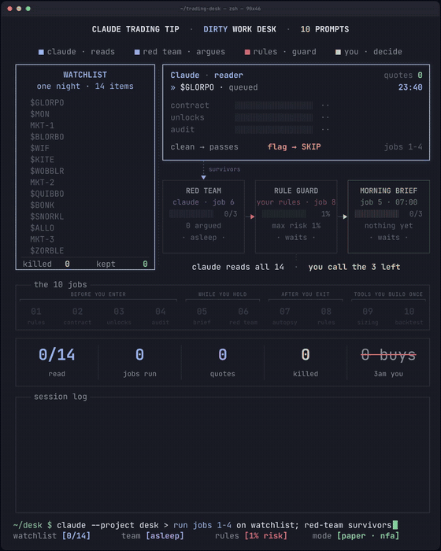

# Trading desk: let Claude do the dirty work

Ten jobs you hand to Claude, each with a copy-paste prompt. Claude reads, checks and argues. You read the verdict and make the call.

From the X article **[I Want Claude to Do All the Dirty Work of Trading (full course)](https://x.com/elessarqq/status/2110353431927869607)**.

## Set it up once

1. Create a Claude Project called **Trading Desk**.
2. Run the [desk profile prompt](prompts/00-desk-profile.md) and answer its questions.
3. Paste the DESK PROFILE it writes into the project's instructions.

From then on every chat in that project knows what you hold and what your rules are, so each prompt below only needs a link, a ticker or a file.

Almost everything works in the normal Claude chat with file upload or web search on. Jobs 2 and 10 go further with Claude Code.

## The jobs

| # | Job | When |
|---|---|---|
| · | [Set up your desk (once)](prompts/00-desk-profile.md) | Setup |
| 1 | [Read the rules before you bet](prompts/01-market-rules.md) | Before you enter |
| 2 | [Check the token contract before you ape](prompts/02-token-contract.md) | Before you enter |
| 3 | [Turn the whitepaper into an unlock calendar](prompts/03-unlock-calendar.md) | Before you enter |
| 4 | [Read the audit report you never open](prompts/04-audit-report.md) | Before you enter |
| 5 | [A morning brief that only covers your bags](prompts/05-morning-brief.md) | While you hold |
| 6 | [Make it argue against your trade](prompts/06-red-team.md) | While you hold |
| 7 | [Do an autopsy on your own trades](prompts/07-trade-autopsy.md) | After you exit |
| 8 | [Make your own rules impossible to ignore](prompts/08-rule-checker.md) | After you exit (and before the next entry) |
| 9 | [A position-size calculator](prompts/09-position-size.md) | Tools you build once |
| 10 | [Backtest an idea before you trust it](prompts/10-backtest.md) | Tools you build once |

## How to start tonight

Pick one job, not ten. The trade autopsy (7) and the rule checker (8) pay off fastest, because the data is already yours and you can run them in the next five minutes. Save every prompt that works, add one job a week, and by the end of the month a set of prompts is doing most of the dirty work.

## Limits

- Claude reads, checks and argues. It can still be wrong, so every number it gives you should come with a source you can open. Every prompt here asks for one.
- Never paste a seed phrase, a private key or an exchange API key into any AI chat. Nothing here needs them.
- The animation above illustrates the flow on a sample watchlist. It is not a recording of a real session.
- Not financial advice.
