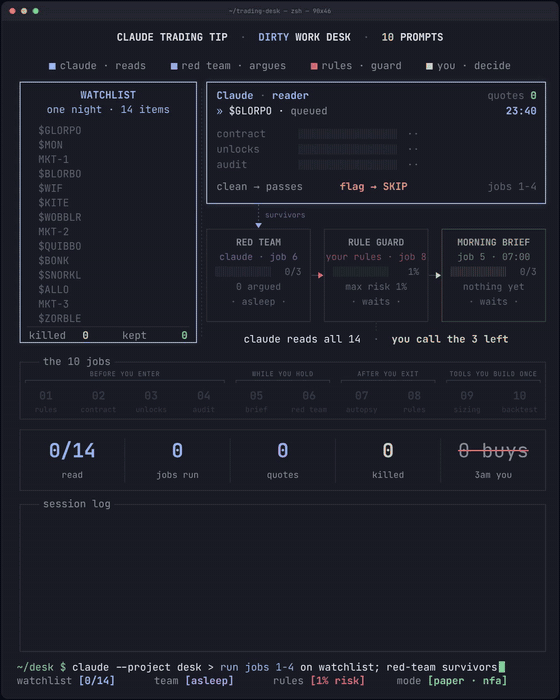

# Video remake: rebuild any viral video format with Claude Code

Take the structure of a video format that already works, pour your own content into it, and render it frame by frame from one HTML page. No After Effects, and nothing copied except the skeleton.

Full walkthrough with receipts: [How to Remake Any Viral Video Format With Claude Code](https://x.com/elessarqq/status/2117300649469571076)

This is what these steps produced for my trading article (an illustration of the workflow, not a screen recording):

## What you need

- **Claude Code** (it has to read files, run commands and look at images)
- **Python + Playwright:** `pip install playwright`, then `playwright install chromium`
- **ffmpeg:** Windows `winget install Gyan.FFmpeg`, Mac `brew install ffmpeg`
- **The reference video** saved as a file in an empty folder

## The 5 steps

Run them in order inside Claude Code. Each step writes a file the next one reads.

| # | Step | Writes |
|---|---|---|
| 1 | [Take the reference apart](prompts/01-breakdown.md) | BREAKDOWN.md |
| 2 | [Map their structure to your content](prompts/02-map.md) | MAPPING.md |
| 3 | [Build it as one page](prompts/03-build.md) | index.html + render.py |
| 4 | [Check stills before you render](prompts/04-check.md) | fixed stills |
| 5 | [Render and ship](prompts/05-render.md) | video, contact sheet, GIF |

## Extras

| Prompt | Use it |
|---|---|
| [Make the motion look expensive](prompts/06-motion.md) | when it renders clean but looks cheap |
| [Save it as a skill](prompts/07-skill.md) | after your first finished video |
| [One page, three formats](prompts/08-formats.md) | when you want vertical and square too |

## Files

- [render.py](render.py): Playwright + ffmpeg renderer for a page that exposes `seek(t)` and `window.ready`. Drop it next to your index.html and run `python render.py stills 0 12 35.9` or `python render.py video out.mp4 --duration 36`.
- [motion.js](motion.js): standard easing curves, durations in frames, a cubic-bezier function and a spring that needs no simulation, so any frame renders on its own.

## Rules

- Real names, tickers and numbers only when the fact is true. Everything else gets an invented name and a demo label.
- A dashboard video illustrates how something works. Don't present it as a recording of a real session.
- Keep the structure, change the layout, and add at least one thing the original didn't have.
- If the value of the original is someone's specific work (their data, research or footage), quote it instead of remaking it.
- No borrowed logos, mascots or characters.
- If someone asks about your setup, say it's a render and how many rounds it took.
